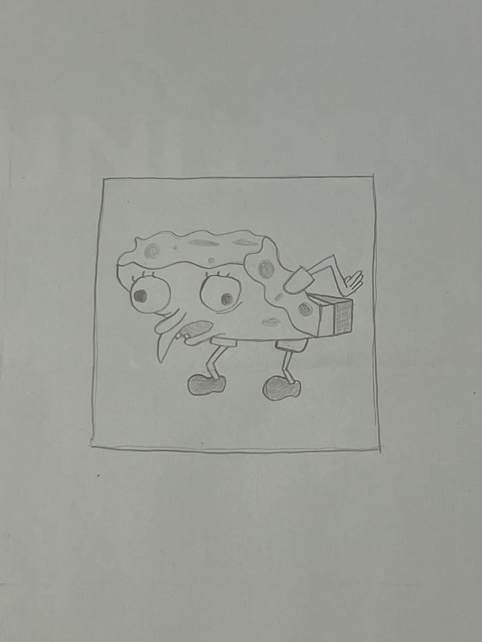
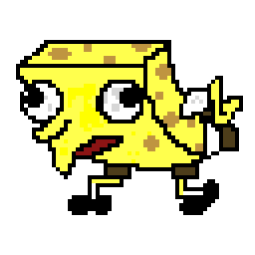
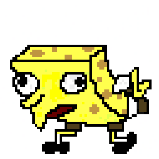
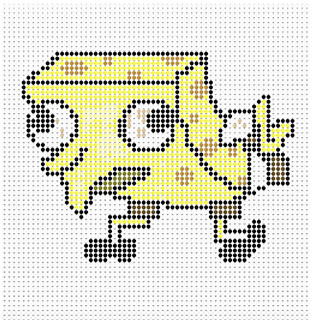
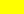
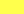
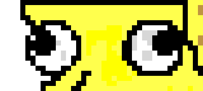

# SpongeBob บน QPU: วาดภาพด้วย Phase 8 ระดับ

ชยกร ศรุตยาพร 6610505331

## 1. บทนำ

โปรเจคนี้วาดภาพ "Mocking SpongeBob" ขนาด 64×64 pixel บน QPU (simulator ของ QCEngine) โดยเก็บสีของแต่ละ pixel ไว้ใน phase ของ state ใช้สีทั้งหมด 8 สี (phase 8 ระดับ ห่างกันทีละ 45°) pixel ส่วนใหญ่ flip ทีละตัวแบบ oracle ของ Grover ส่วนตาวาดด้วยสมการวงกลม

| ภาพ proposal (วาดมือ) | ภาพผลลัพธ์จาก QPU (64×64) |
|:---:|:---:|
|  |  |

## 2. ขั้นตอนการทำงาน (pipeline)

| ไฟล์ | หน้าที่ |
|---|---|
| [`drawing_64.png`](drawing_64.png) | วาดภาพเป็น pixel art 64×64 จาก proposal (ใช้ makebead.com) |
| [`png_to_rows.py`](png_to_rows.py) | แปลงสีของแต่ละ pixel เป็นตัวอักษร 1 ตัว ได้ภาพเป็นข้อความ 64 บรรทัด, เลื่อนภาพขึ้น 8 แถวให้อยู่กลางกรอบ และลบตาออก (เพราะตาจะวาดด้วยสมการแทน) |
| [`spongebob.js`](spongebob.js) | code หลักที่รันบน QCEngine: สร้าง superposition, flip phase ทีละ pixel, วาดตาด้วยวงกลม แล้วพิมพ์ phase ของทุก pixel ออกมา |
| [`render_png.py`](render_png.py) | อ่าน phase ที่พิมพ์ออกมา ([`phases.txt`](output/phases.txt)) แล้วลงสีเป็นไฟล์ PNG |

| `drawing_64.png` (ภาพตั้งต้น) | circle notation ใน QCEngine (screenshot) |
|:---:|:---:|
|  |  |

## 3. แนวคิด: เก็บภาพไว้ใน phase

ใช้ register `qx` 6 qubit และ `qy` 6 qubit รวมเป็น 12 qubit = 4,096 state พอดีกับ 64×64 pixel โดย pixel (x, y) คือ state |y·64 + x⟩ เริ่มจากทำ HAD ทุก qubit จะได้ทุก state มี amplitude เท่ากันคือ 1/64 และ phase 0° (= ภาพขาวทั้งผืน) จากนั้นเปลี่ยน phase ของ state ที่ต้องการลงสี ขนาดของทุกวงใน circle notation จึงเท่ากันหมด สิ่งเดียวที่ต่างคือมุมของ phase

สีที่ใช้มี 8 สี จับคู่กับ phase ดังนี้ (ในโค้ดใช้ตัวอักษรแทนสีเพื่อให้พิมพ์ภาพเป็นข้อความได้)

| phase | ตัวอักษร | สี | ใช้กับ | จำนวน pixel |
|---:|:---:|---|---|---:|
| 0° | `.` |  ขาว | พื้นหลัง | (ไม่ต้อง flip) |
| 45° | `Y` |  เหลืองสด | ไฮไลต์บนตัว | 62 |
| 90° | `y` |  เหลือง | ตัว | 682 |
| 135° | `r` |  แดงเข้ม | ปาก | 17 |
| 180° | `#` |  ดำ | เส้นขอบ, รองเท้า | 505 |
| 225° | `d` |  น้ำตาลเข้ม | กางเกง | 36 |
| 270° | `b` |  น้ำตาล | รูพรุน | 80 |
| 315° | `g` |  เทา | แรเงาในตา | 19 |

รวม pixel ที่ต้อง flip ทั้งหมด 1,401 pixel (นอกจากนี้ยังมีตาอีก 6 วงกลม)

## 4. เทคนิคที่ใช้

### 4.1 pixel แบบ hard-code: flip ทีละ pixel

ใช้วิธีเดียวกับ oracle ของ Grover ใน Lec06 ถ้าจะเปลี่ยน phase ของ state |index⟩ แค่ตัวเดียว ให้ NOT เฉพาะบิตที่เป็น 0 ของ index ก่อน state นั้นจะกลายเป็น |111111111111⟩ จากนั้นใช้ CPHASE ที่ต้องให้ทั้ง 12 qubit เป็น 1 แล้ว NOT กลับคืน

```js
function flip(x, y, angle) {
  var index = y * 64 + x;
  qc.not(~index & 0xFFF);
  qc.cphase(angle, 0xFFF);
  qc.not(~index & 0xFFF);
}
```

จากนั้นวนทุก pixel ในภาพ ถ้าไม่ใช่สีขาวก็เรียก `flip()` ด้วยมุมของสีนั้น แต่ละ pixel ต้อง flip ครั้งเดียว เพราะถ้า flip หลายทีจะทำให้ phase บวกสะสมกันจนสีเพี้ยน

### 4.2 ตาแบบสมการวงกลม

ตาเป็นวงกลม ถ้า hard-code ก็ต้องไล่ใส่ทีละ pixel จึงใช้วิธีสร้างตามสมการวงกลมแทน คือคำนวณ (x−cx)² + (y−cy)² − r² ลงใน register `qacc` (8 qubit) ถ้าผลติดลบ แปลว่า pixel อยู่ในวงกลม (ระยะจากศูนย์กลางน้อยกว่ารัศมี) และค่าติดลบแบบ two's complement จะมีบิตบนสุดเป็น 1 จึง CPHASE โดยใช้บิตนั้นเป็นเงื่อนไข เสร็จแล้วต้อง uncompute ให้ `qacc` กลับเป็น 0 ไม่อย่างนั้น `qacc` จะ entangle อยู่กับ `qx`, `qy` และภาพจะไม่ได้อยู่ใน phase อย่างเดียวอีกต่อไป

ปัญหาที่เจอระหว่างทำ:

- `addSquared` ของ QCEngine คิดเลขแบบไม่มีเครื่องหมาย จึงยกกำลังสองค่า (x − cx) ที่ติดลบไม่ได้ และคำสั่ง `make_sub_int` ที่น่าจะช่วยได้ก็รันแล้ว error ผมจึงเลื่อนศูนย์กลางไปไว้ที่ 8 ด้วย `qx.subtract(cx-8)` แล้วใช้ (x−8)² = x² − 16x + 64 ซึ่ง x² มาจาก `addSquared`, −16x มาจาก `subtractShifted(qx, 4)` (shift 4 บิต = คูณ 16) และ +64 เป็นค่าคงที่
- `qacc` มีแค่ 8 บิต ถ้า pixel อยู่ไกลจากศูนย์กลางมาก ผลรวมจะล้นแล้ววนกลับมาติดลบ จึงให้ CPHASE ทำงานเฉพาะในกรอบ 16×16 รอบศูนย์กลาง (บิต 4 และ 5 ของ x และ y ต้องเป็น 0)

ตาแต่ละข้างใช้วงกลม 3 วง และใช้ประโยชน์จากการที่ phase บวกสะสมกัน:

- วงนอก 180° แล้ววงในซ้อนอีก 180° → ข้างในได้ 360° = 0° (ขาว) เหลือแต่ขอบดำเป็นวงแหวน
- ตาดำ 180° วางทับบนพื้นที่ขาว → กลายเป็นดำ



| ตา | วงนอก (ศูนย์กลาง, r²) | วงใน (r²) | ตาดำ (ศูนย์กลาง, r²) |
|---|---|---|---|
| ซ้าย | (10, 25), 30 | 20 | (8, 24), 8 |
| ขวา | (30, 25), 36 | 25 | (32, 24), 8 |

### 4.3 อ่านผลออกมาเป็นภาพ

หลังรันวงจรเสร็จ code จะอ่านค่า amplitude ของทุก state จาก simulator แล้วแปลงเป็นมุม phase (QCEngine เก็บ phase เป็น e^(−iφ) จึงต้องใส่เครื่องหมายลบกลับ) แล้วพิมพ์ออกมาเป็นตัวเลข 0–7 (= มุม / 45°) จากนั้น `render_png.py` ลงสีตามตารางในหัวข้อ 3

## 5. ผลลัพธ์

- ใช้ทั้งหมด **20 qubit** (qx 6 + qy 6 + qacc 8) รันใน QCEngine
- phase ของทั้ง 4,096 pixel ตรงกับภาพที่ตั้งใจไว้ทุก pixel
- หลังวาดตาเสร็จ qacc กลับเป็น 0 ครบ และ amplitude ทุกช่องยังเป็น 1/64 เท่ากัน

สีใน screenshot ของ QCEngine (หัวข้อ 2) ไม่ตรงกับภาพ PNG ทั้งหมด เพราะ QCEngine ให้ตั้งสีได้แค่ 4 ทิศ (0°, 90°, 180°, 270°) ส่วนมุมระหว่างกลางจะเป็นสีผสมของ 2 ทิศข้างเคียง สีปาก (135°) และสีเทาในตา (315°) ในหน้าจอจึงเพี้ยน แต่ใน PNG ใช้ตารางสีที่ตั้งเองครบทั้ง 8 สี

## 6. ข้อจำกัดและสิ่งที่ต่อยอดได้

- **วงจรยาว:** flip ทีละ pixel ใช้ 3 คำสั่งต่อ pixel รวมประมาณ 4,200 คำสั่ง ถ้าจะลดให้สั้นลง ทำได้โดยรวม pixel ที่ติดกันเป็นบล็อกหรือเส้น เช่น ถ้าบล็อกขนาด 2×2 สีเดียวกันทั้งบล็อก ก็ไม่ต้องใช้บิตล่างสุดของ x และ y เป็นเงื่อนไข flip ครั้งเดียวก็ได้ทั้ง 4 pixel
- **อ่านภาพได้เฉพาะบน simulator:** การอ่าน phase ทั้ง 4,096 ค่าใช้วิธีดู state vector ตรง ๆ ถ้าเป็น QPU จริง READ จะได้แค่ (x, y) แบบสุ่มมา 1 ค่า และมองไม่เห็น phase
- **Supersampling (QSS, Lec11):** ลองคิดแล้วว่าถ้าจะวาดที่ 256×256 แล้วยุบเป็น 64×64 ภาพนี้จะไม่ได้ขอบที่นุ่มขึ้น เพราะ pixel art ไม่มีรายละเอียดเล็กกว่า 1 pixel พอขยายแล้ว 1 pixel กลายเป็นบล็อก 4×4 สีเดียวกันทั้งบล็อก ยุบกลับก็ได้ภาพเดิม ส่วนที่จะได้ประโยชน์มีแค่ตาที่เป็นสมการ ถ้าจะใช้ QSS ให้คุ้มต้องเปลี่ยนส่วนอื่นของภาพเป็นสมการก่อน และเนื่องจาก QSS ให้ค่าออกมาเป็นความสว่าง ไม่ใช่ phase จึงต้องเปลี่ยนวิธีลงสีเป็น bitplane แทน
